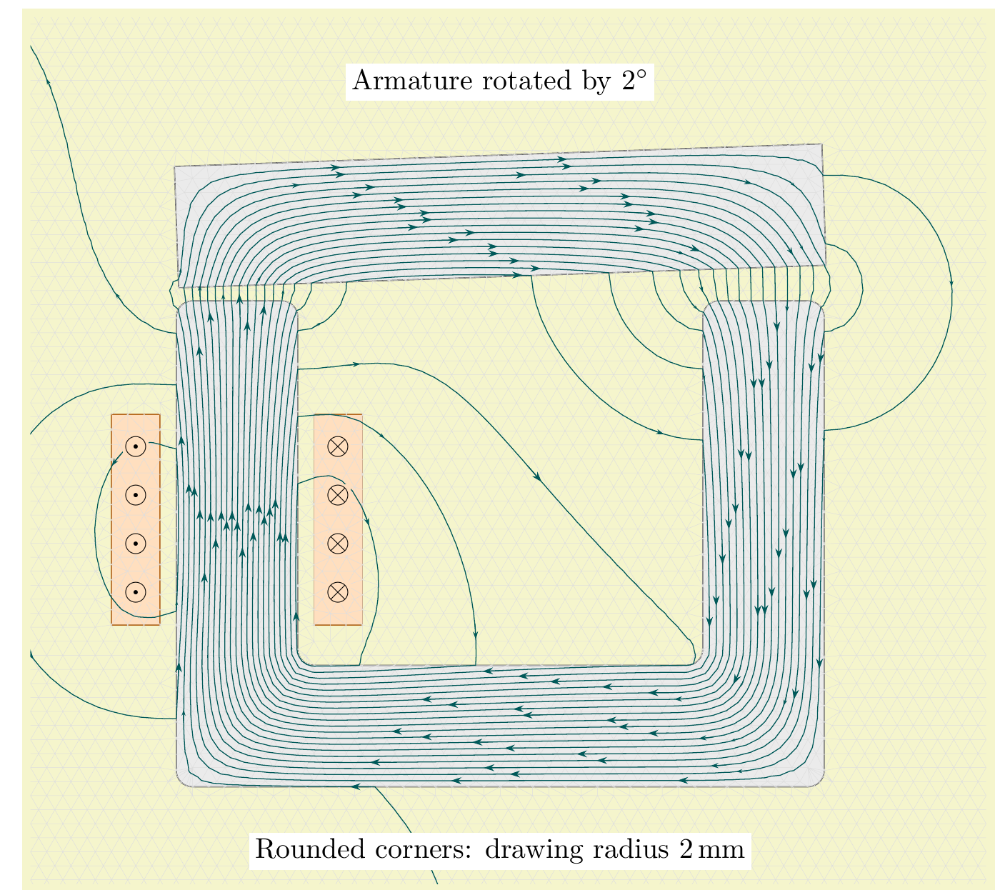
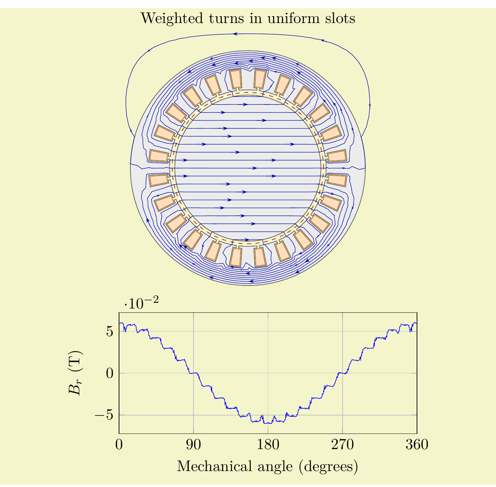
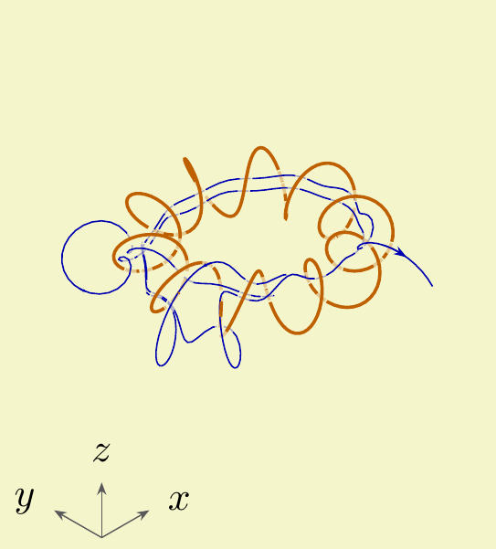
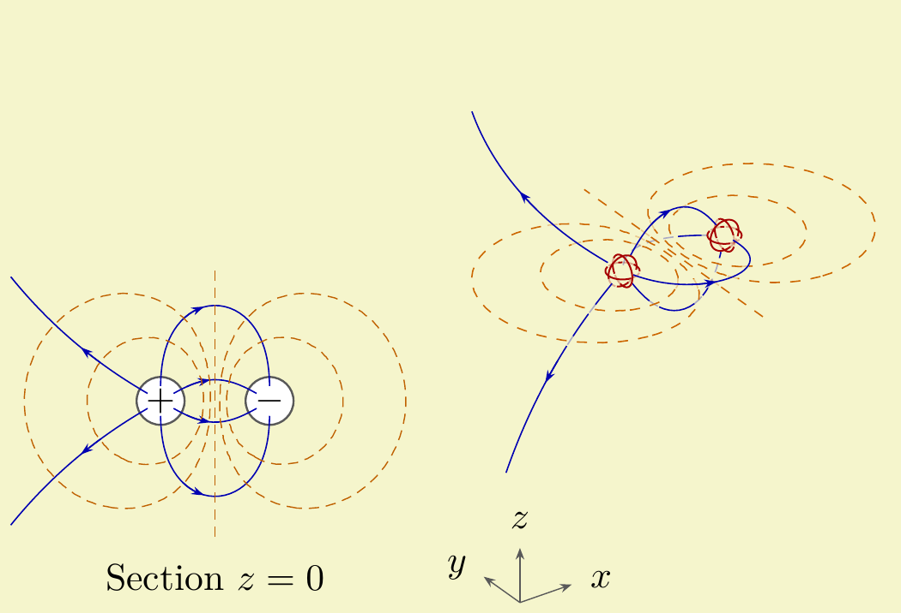

# luafemm

**Version 0.36.0-rc.1 — 2026-11-27**

A generic LuaTeX library for **TikZ, PGF and PGFPlots**: describe magnetic and
electric models with ordinary paths, nodes and `key=value` styles, calculate in
Lua, and draw oriented field lines, equipotentials and quantitative profiles.
It works with **plain LuaTeX, LuaLaTeX and ConTeXt MkIV**, without a native solver
or shell escape.

[Read the illustrated manual](doc/luafemm-manual.pdf) ·
[Download a release](https://github.com/cjorssen/luafemm/releases) ·
[Report a bug](https://github.com/cjorssen/luafemm/issues)

| Tilted U electromagnet | Slotted machine |
| :---: | :---: |
| [](examples/curved-core.tex) | [](examples/tutorial-machine-sine.tex) |
| A curved iron core and the field in its nonuniform gaps. | Distributed winding currents shape the angular gap field. |

| Helical toroid | Electric dipole |
| :---: | :---: |
| [](examples/helical-toroid-view.tex) | [](examples/electric-spatial-views.tex) |
| Reuse one 3D calculation with different cameras. | Keep electric field lines and equipotentials visually distinct. |

These previews are cropped from the manual's executed examples. Click a figure
for its complete source. Start with the tutorials for electromagnets, permanent
magnets, machines, eddy-current testing or electrostatics, then use the key
reference to customize a model.

## First picture

```tex
\documentclass{article}
\usepackage{tikz,pgfplots}
\usetikzlibrary{femm}
\usepgfplotslibrary{femm}
\pgfplotsset{compat=1.18}
\begin{document}
\begin{tikzpicture}[scale=.65,
  femm/problem={xmin=-85,xmax=85,ymin=-65,ymax=85,mesh size=4}]
  \node[femm/u electromagnet={gap=3,ampere turns=6000}] (M) {};
  \path[femm/profile={name=gap,samples=101}]
    (M.left pole)--(M.left armature);
  \pic[femm/lines=19] {femm field};
\end{tikzpicture}
\par\medskip
\begin{tikzpicture}
\begin{axis}[width=10cm,height=5cm,
  xlabel={Distance (mm)},ylabel={Field (T)},grid=major]
  \femmplot[profile=gap,component=B,plot options={blue,thick}]
\end{axis}
\end{tikzpicture}
\end{document}
```

Compile with `lualatex`. Begin with a coarse mesh; refine the gaps and check
mesh and exterior-domain sensitivity before relying on a quantitative result.

Declare **all materials, physical paths, component nodes, circuits and boundaries
before the first mesh, field or measurement request**. A profile declaration does
not solve; plotting it does. The manual explains operation order and scope.
Options use PGF keys and ordinary `.style`/`.append style` definitions; TikZ paths,
transformations, nodes and drawing options retain their usual roles.

## Supported physics and figures

- Nonlinear static B–H curves, permanent magnets, linear anisotropy, planar and
  axisymmetric formulations, tagged and periodic boundaries, and a circular
  exterior approximation within their documented restrictions.
- Nonlinear directional iron/insulator sheets in DC, with orientation, fill,
  consistent energy and static incremental/frozen responses.
- A versioned catalogue of 282 FEMM 5 magnetic and nonmagnetic material records. Having a
  catalogue record does not imply support for all its frequency-dependent laws.
- Pure-Lua constrained triangular meshing, local spacing and bounded optional
  angle/area refinement, automatic spatial acceleration and explicit rejection
  of impossible constrained-corner angle targets. Arbitrary TikZ curves are flattened with a geometric
  tolerance; the original drawing remains a TikZ path.
- U and E cores, toroids and tapered toroids, permanent-magnet sections, and
  configurable slotted rotor/stator shapes. Ideal confined-flux models preserve
  branch flux and provide mean magnetic paths.
- Linear harmonic eddy currents, skin/proximity redistribution, coupled voltage
  and current ports, series/parallel branches and isolated solid conductors.
  Peak phasors use `exp(+i omega t)`.
- Complex linear permeability and insulated-sheet effective laws, with separate
  intrinsic magnetic, microscopic sheet and resolved Joule losses.
- Effective round, stranded, Litz, square and CCA windings, with transport/proximity losses.
- Passive native `.femx`/`.ansx` persistence for supported electric and magnetic providers.
- Nonlinear equivalent-amplitude harmonic materials with a prescribed loss angle.
- Axisymmetric Kelvin exterior regions and scaled flux pairing.
- Magnetic colour maps, PGFPlots colour bars and normalized or scaled B/H vectors.
- Planar residual-driven conforming mesh refinement with explicit budgets.
- Explicit lossless nonlinear fundamental fields from piecewise-linear B--H data.
- Static operating-point captures, frozen/incremental responses, small harmonic
  responses about a fixed DC tangent, and independent static/harmonic moving-band positions.
- Rotational sector pairing, full-circle Fourier analytical gaps, angle sweeps
  and differential linkage/impedance matrices.
- Planar previous-solution FEM/ANS exchange with owned DC companions.
- Signed harmonic periodicity and first-order biased force/torque responses,
  with native PGF styles and automatic fundamental-frequency waveform plots.
- Field contours and current views, scalar/vector plots, curved profiles and
  spatial harmonics, selections and integrals, static and harmonic force/torque methods,
  circuit observables and PGFPlots parameter series.
- Checked pure-Lua sparse solves with bounded factorisation recovery and original-system residual verification.
- Passive versioned calculation caches and the documented static/harmonic FEM/ANS subset.
  FEM export approximates arbitrary TikZ curves by controlled straight segments.

These capabilities have explicit combination and geometry limits. General nonlinear
harmonic waveforms, continuous rotor
motion, resolved individual-strand models and full FEMM parity are not supported.
The manual distinguishes the axial long-conductor reduction from the planar and
axisymmetric potential formulations. This is not a complete Triangle or Tangle
port. A small algebraic residual does not establish discretisation accuracy.

## Examples and manual

The English manual uses PGF's documentation environments, with guided tutorials,
full key paths/defaults, units, operation order, numerical methods and limitations.
Focused code/result examples execute directly inside the manual, with shared
setup shown explicitly. Narrative characters appear only in the tutorials.
Complete document listings are reserved for the format appendix; its plain and
ConTeXt demonstrations are compiled separately in their actual formats.
Downloadable full examples remain available independently of the manual.

| Example | Question |
| --- | --- |
| [U electromagnet](examples/tutorial-coil.tex) | How do winding current, field lines and gap profiles connect? |
| [Permanent magnet](examples/tutorial-alnico.tex) | How does an alnico section drive a soft-iron return path? |
| [Slotted machine](examples/tutorial-machine-sine.tex) | How can distributed currents shape the angular gap field? |
| [Nondestructive testing](examples/tutorial-ndt-scan.tex) | How do groove depth and probe position change coil impedance? |
| [Machine response](examples/machine-response.tex) | How do biased torque responses differ from unbiased AC ripple? |
| [Periodic AC cell](examples/periodic-harmonic.tex) | How does diffusion behave in a periodic conducting strip? |
| [Sheet losses](examples/harmonic-materials.tex) | How does sheet thickness affect losses versus frequency? |
| [Round and Litz windings](examples/wire-windings.tex) | How do skin/proximity effects change losses at equal copper area? |
| [Nonlinear fundamental](examples/nonlinear-fundamental.tex) | How does a saturated core differ from a static solve at peak current? |
| [Static forces](examples/forces.tex) | How does armature gap affect attraction? |

## Installation and dependencies

In the browsing archive or GitHub checkout, runtime files are under `tex/`
and Lua modules under `tex/lua/`. Copy the **contents** of `tex/` into
`TEXMF/tex/luatex/luafemm/`, preserving the `lua/` subdirectory:

```text
tex/luatex/luafemm/          TeX libraries and format loaders
tex/luatex/luafemm/lua/      Lua modules
```

Keep all files from one version together. Missing components produce an error;
modules from another installation are not used to complete a partial package.
Refresh the tree's filename database if its configuration requires it.
The optional `.tds.zip` already contains these installation paths and can be
extracted at a TEXMF root. Documentation belongs under
`TEXMF/doc/luatex/luafemm/`. Do not install the browsing ZIP as though it were a TDS ZIP.

In plain LuaTeX, load `tikz.tex` and use `\usetikzlibrary{femm}`; load
`pgfplots.tex` and `\usepgfplotslibrary{femm}` for profiles. In LuaLaTeX the
same libraries work after loading `tikz,pgfplots`; `\usepackage{luafemm}` is
also available. In ConTeXt MkIV, use `\usemodule[luafemm]`, and load the
`pgfplots` module/library for plots. Select LuaTeX explicitly when the default
ConTeXt engine is LuaMetaTeX. Complete wrappers are in [examples/formats](examples/formats).

Runtime dependencies are LuaTeX and the chosen format's PGF/TikZ/PGFPlots
installation. Neither FEMM, xfemm, Triangle, Tangle, Python nor a compiler is
required to use the library. Observed platform and engine versions are recorded
in [validation notes](doc/validation.md); Windows FEMM GUI
acceptance is not claimed.

To rebuild the manual from the browsable source archive, run from its root:

```sh
python3 doc/build-manual.py
```

This needs Python 3, LuaLaTeX, plain LuaTeX, ConTeXt MkIV, the installed PGF manual
macros, the LaTeX packages named in the manual preamble, MakeIndex, and
pdfcrop/Ghostscript for the three native-format demonstrations. It writes only
under `build/`. It does not download software or require shell escape.
The requested CTAN category is `/macros/luatex/generic/luafemm`; this archive
category is distinct from the installed TDS paths and TeX Live import rules.

## Author, licence and validation

**Christophe Jorssen <christophe.jorssen@gmail.com>** is the author and Current
Maintainer; LPPL maintenance status: **maintained**. Original code and documentation
use **LPPL 1.3c or later**. See [LICENSE](LICENSE), [LICENSES.md](LICENSES.md) and
[MANIFEST.md](MANIFEST.md). FEMM catalogue data and their generated derivatives
retain the MIT terms recorded in [data provenance](data/femm5/README.md).
The optional FEMM 4 catalogue must be supplied by the user and is not bundled.
They are not relicensed as LPPL.

The implementation draws on studying FEMM/xfemm and Triangle formulations and
algorithms, reimplemented in Lua/LuaTeX. No native solver/mesher source or binary
is included. See the retained data provenance and notices.

The package was **vibe-coded with OpenAI Codex and the Astra-6 model**, under
Christophe Jorssen's direction. Neither AI assistance nor publication certifies
scientific correctness. Independently validate computed results and material
assumptions, including mesh and domain convergence.
